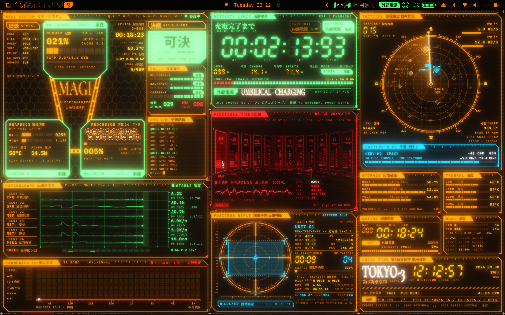
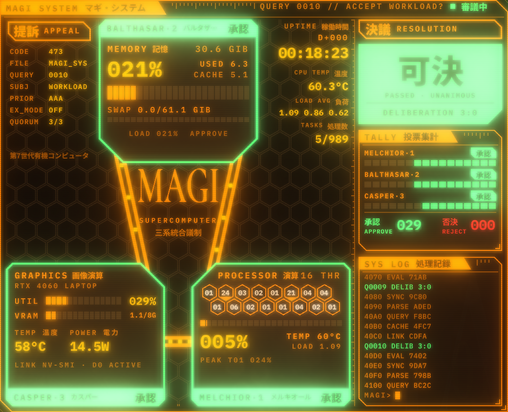
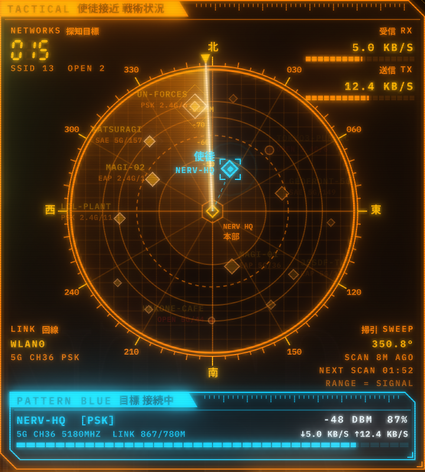
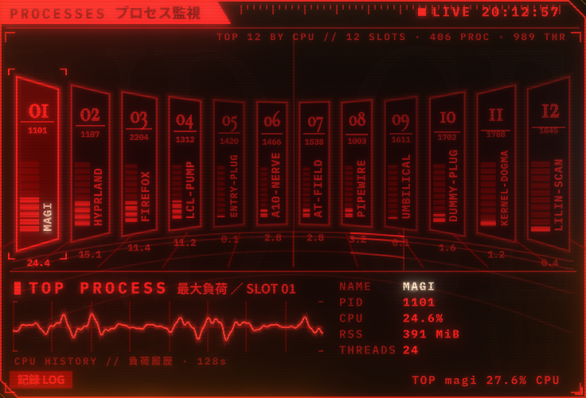
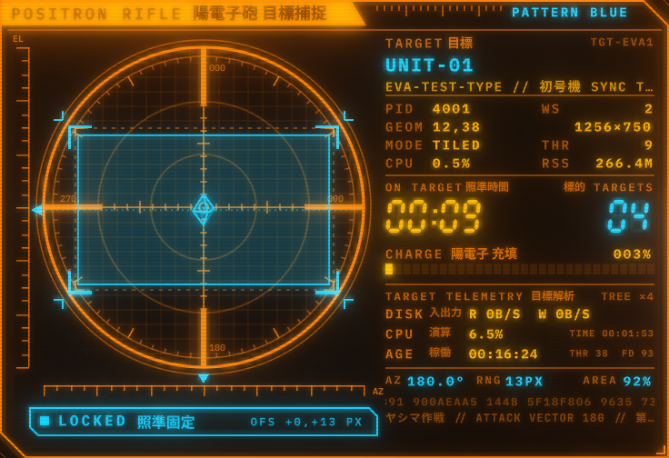
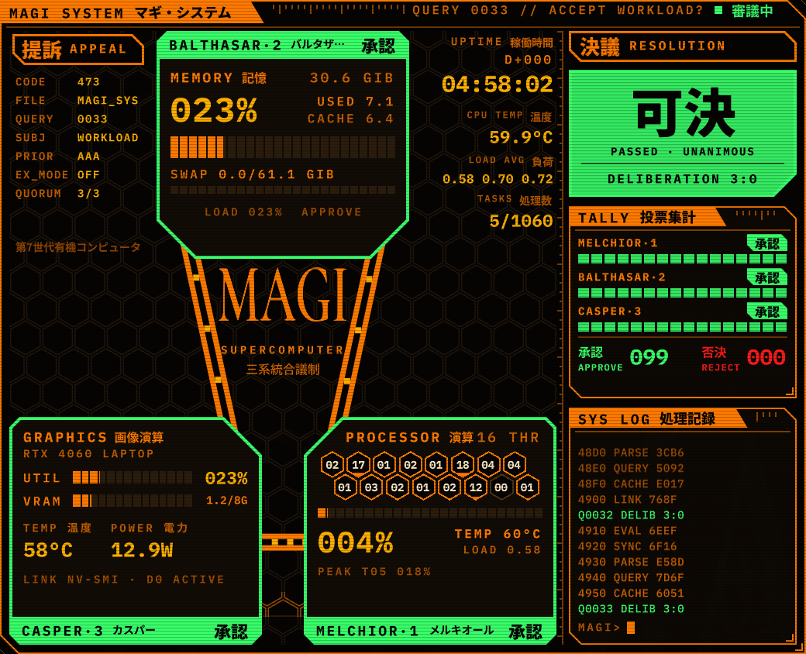
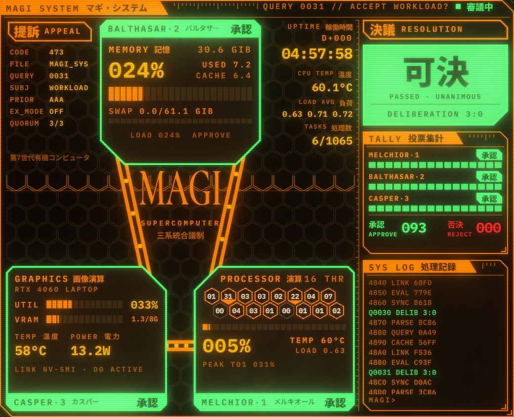
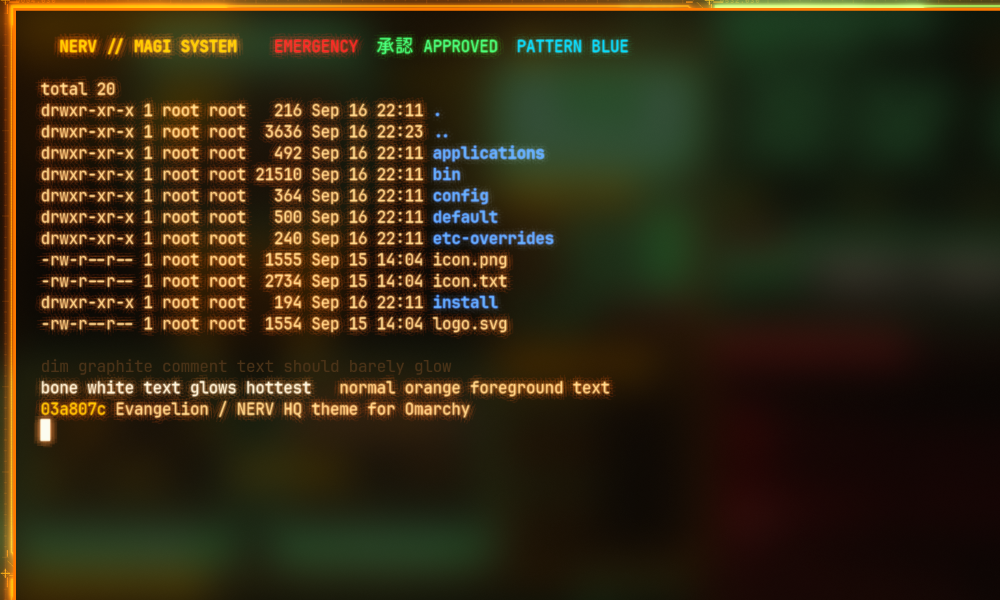

# Evangelion — a NERV HQ theme for Omarchy

An [Omarchy](https://omarchy.org) theme that turns the desktop into the NERV HQ command terminal: terminal black, command orange, emergency red, bilingual labels, chamfered panels, hex grids and 7-segment digits. It's based on the generative music video **[EVANGELION — "Neon Overdrive"](https://github.com/bizarro/evangelion)** by Luis Bizarro, and includes a live desktop wall of system diagnostics that runs at your monitor's refresh rate with a CRT-style bloom and dirty-lens glow.



> Screenshots are taken in demo mode (`"demo": true` in `nerv-wall.json`), so network contacts, processes and window titles are synthetic.

## What's included

### Theme
- **Colours:** ink `#050403`, command orange `#FF7A00`, amber `#FFB000`, emergency red `#FF1A1A`, phosphor green `#39FF6A`, pattern blue `#00C8FF`, and Unit-01 purple and lime.
- **Hyprland:** square corners, an orange-to-amber active border, a faint orange glow on the focused window, dimmed inactive windows and snappy animations.
- **Shell surfaces:** themed bar, launcher, menus, lock screen, notifications, popups, tooltips and polkit dialog.
- **Apps:** btop, Neovim (aether.nvim palette), icons, Chromium and keyboard RGB.
- **Nine 2560×1600 wallpapers**, each drawn as a frozen frame of the video: CONTROL WALL, MAGI SYSTEM, A.T. FIELD, TOKYO-3, the NEON OVERDRIVE episode card, PATTERN BLUE, SOUND ONLY, ACTIVITY LIMIT and BERSERK. Also a Plymouth `unlock.png` reading "AUTHORIZATION REQUIRED".

### Bar widgets
| Widget | What it does |
|---|---|
| `zalo.nerv-magi` | CPU, memory and GPU as **MELCHIOR·1 / BALTHASAR·2 / CASPER·3**. Click for the MAGI deliberation screen, with per-thread hex cells and 承認/否決 (approve/reject) votes. Never wakes a sleeping NVIDIA dGPU. |
| `zalo.nerv-power` | The **ACTIVITY LIMIT** clock: time-to-empty in real 7-segment digits, showing 内部電源 (internal power) or 外部電源 (external power) depending on AC. Click for the big countdown with ticking hundredths and power-profile buttons. |
| `zalo.nerv-workspaces` | Chamfered workspace cells with 7-segment numbers. The active one is solid orange, and urgent ones blink red. |

### The desktop wall (`zalo.nerv-wall`)
A click-through layer between the wallpaper and your windows holds six live panels, laid out by `~/.config/omarchy/nerv-wall.json`:

| Panel | Signal |
|---|---|
| **MAGI SYSTEM** | CPU, memory and GPU processors voting, with a tally and a scrolling system log |
| **PSYCHOGRAPH / HARMONICS** | Six phosphor scope traces, each plotting its real metric with a visible scale: CPU %, GPU %, memory %, network ↓, network ↑, and internet latency (a TCP connect to 1.1.1.1 every 8 s, OFFLINE when it fails). Below them, a per-core strip, disk throughput and a real-time spectrum of whatever audio is playing |
| **ACTIVITY LIMIT** | Battery countdown, umbilical (AC) state, drain rate and health |
| **PROCESSES** | The top 12 processes by CPU as SEELE monoliths, with name and PID. Seats are stable, the top process gets a GPU-shaded CPU-history oscilloscope, and a plain-language log records processes starting, exiting and changing slots |
| **POSITRON RIFLE** | A targeting scope locked onto your focused window. **Target telemetry** is summed over the window's whole process tree: disk read/write rate, CPU and CPU time, process age, threads and open files. Real window geometry: offset, bearing and distance from screen centre, and screen coverage |
| **TACTICAL** | Radar of **nearby WiFi networks**: bearing per access point, distance = signal strength, diamonds for secured and circles for open, labelled with security, band and channel. The connected network is the cyan PATTERN BLUE contact, with dBm, channel, link rate and traffic. A real scan runs at most every 10 minutes and results are cached in between. Below the radar: storage, temperatures, uptime, and a **local-time clock titled with your timezone's city** |

| | |
|---|---|
|  |  |
|  |  |

- **Motion:** everything animates at the display refresh rate, while data is sampled every 1–3 s and eased in between.
- **Pausing:** when the current workspace has windows, the animation stops and the wall stays frozen behind them, redrawn only on its 1–3 s data ticks, so it shows through glass terminals. That costs about 2% of one core; an empty desktop with the wall animating costs about 35–40%.
- **Glow:** a port of **[SE Natural Bloom & Dirty Lens](https://github.com/sonicether/SE-Natural-Bloom-Dirty-Lens)**. It uses 13 GPU passes, only one of them at full resolution. A brightness boost makes orange strokes and 7-segment digits bloom while dim lines stay crisp, and it adds a dirty-lens glare plus the video's carmine halation.

| Bloom off | Bloom on |
|---|---|
|  |  |

### Glass terminal with phosphor glow


- **Glow:** the theme's `ghostty.conf` adds `ghostty-bloom.glsl`, a single-pass Ghostty shader. It gives every glyph a tight halo and a warm wide haze, weighted by brightness so bold colours glow hottest and dim comments stay crisp. It covers everything that runs in the terminal (Neovim, btop, lazygit…) and only runs when the terminal redraws.
- **Glass:** the terminal background is 62% opaque. The theme turns on Hyprland blur, which only affects translucent windows, so the frozen wall shows through as blurred orange, green and cyan light.
- **Theme-scoped:** switching themes regenerates `ghostty.conf` without the shader and opacity.

### EMERGENCY alerts
`nerv-alert` plays a full-screen, click-through NERV alarm with four variants: `emergency`, `pattern-blue`, `activity-limit` and `sync`.

```sh
nerv-alert pattern-blue "Angel approaching"
nerv-alert --json '{"variant":"emergency","title":"EMERGENCY","message":"…"}'
```
The `battery-low` hook fires the activity-limit alarm, and switching to the theme plays a short sync sequence. Both only run while this theme is active.

## Install

```sh
git clone https://github.com/sh1ftmaker/omarchy-evangelion-theme
cd omarchy-evangelion-theme
./install.sh
```

The installer does the following:
- **Theme:** copies it into `~/.config/omarchy/themes/evangelion`.
- **Fonts:** installs Cormorant Garamond and IBM Plex Mono into `~/.local/share/fonts/nerv`.
- **Plugins, layout and CLI:** copies the shell plugins, the default `nerv-wall.json` and `nerv-alert`.
- **Hooks:** installs them with `omarchy hook install`.
- **Apply:** runs `omarchy theme set evangelion`.

The `nerv-mode` theme-set hook turns the NERV widgets and wall on under this theme, and turns them off (restoring the stock workspace switcher) under any other theme.

**Theme only:** `omarchy theme install https://github.com/sh1ftmaker/omarchy-evangelion-theme` works too. Omarchy drops the `.lua` files from cloned themes, so you lose the Hyprland look and Neovim colours, and you get none of the widgets.

**Uninstall:** switch to another theme, then run `./uninstall.sh` (add `--all` to also remove the theme folder, fonts and layout).

Tested on Omarchy with Hyprland (Lua config), Quickshell 0.3.1 and Qt 6.11. The audio spectrum needs PipeWire/PulseAudio (`parec`, `pactl`). The WiFi radar uses NetworkManager (`nmcli`) and `iw`, and falls back gracefully without them. Everything else reads `/proc`, `/sys`, UPower and Hyprland directly. Python 3 is used for three small helper processes. No other dependencies.

## Configuration

`~/.config/omarchy/nerv-wall.json` is watched live:

```jsonc
{
  "reference": { "width": 1280, "height": 800 },   // rects below are in this grid, scaled to your screen
  "fillAlpha": 0.82,                                // panel background opacity
  "bloom": true,
  "bloomParams": { "intensity": 0.88, "scatter": 0.35, "lensDirtIntensity": 0.2, "hdrBoost": 8, "halation": 0.2 },
  "behindWindows": true,                            // keep the wall drawn (frozen) behind windows, for glass
  "demo": false,                                    // synthetic data for screenshots: fake WiFi, processes, target, Tokyo-3 time
  "panels": { "zalo.nerv-magi-desk": { "x": 8, "y": 34, "w": 520, "h": 422 }, "...": {} }
}
```

- **Glow:** `intensity` controls the glow strength, `scatter` makes it tighter or a wider haze, and `hdrBoost` sets how strongly bright colours stand out.
- **Moving panels:** move or resize a rect and save; the panels re-pack immediately. The `0-control-wall.png` backdrop is drawn to the default layout. Re-render it from `extras/wallpaper-src/wall/control.html` if you change the layout.
- **Show or hide panels:** `omarchy-shell nerv-wall toggle|status` for the whole wall, `omarchy-shell nerv-<panel> toggle` for one panel (`nerv-magi-desk`, `nerv-power-desk`, `nerv-seele`, `nerv-target`, `nerv-psychograph`, `nerv-tactical`).
- **Behind windows:** set `"behindWindows": false` to drop the wall entirely while windows cover it. That's slightly cheaper when every window is opaque.
- **Terminal:** set glass opacity with `background-opacity` in the theme's `ghostty.conf`, and glow strength with `TIGHT_GAIN` / `WIDE_GAIN` in `ghostty-bloom.glsl`. Then run `omarchy theme set evangelion && omarchy restart terminal`.
- **Fonts:** the shell's own font is system-wide. `omarchy font set "IBM Plex Mono"` completes the look.

## Repository layout

```
./                          theme root (colors.toml, hyprland.lua, shell.*.toml, btop, neovim, backgrounds/, …)
extras/plugins/             Quickshell plugins: zalo.nerv-{magi,power,workspaces,alert,wall} and the six wall panels
extras/hooks/               theme-set (nerv-mode, nerv-sync-start) and battery-low hooks
extras/bin/nerv-alert       alert CLI
extras/config/              default nerv-wall.json
extras/fonts/               Cormorant Garamond + IBM Plex Mono (OFL)
extras/wallpaper-src/       HTML/Canvas sources for every wallpaper (render with headless Chromium: ./render.sh <name>)
docs/                       design brief and screenshots
```

The `zalo.` prefix on plugin ids is the author's Omarchy plugin namespace; ids only need to be unique.

## Credits

- Visual language, palette, UI kit and plate concepts: [bizarro/evangelion](https://github.com/bizarro/evangelion) (MIT).
- Bloom: [sonicether/SE-Natural-Bloom-Dirty-Lens](https://github.com/sonicether/SE-Natural-Bloom-Dirty-Lens) (MIT).
- Fonts: Cormorant Garamond and IBM Plex Mono (SIL OFL 1.1).
- Built with [Claude Code](https://claude.com/claude-code).

Evangelion and NERV are trademarks of their respective owners. This is a fan-made homage that borrows the genre's UI language, not its logos or footage. Code is MIT; see [LICENSE](LICENSE).
